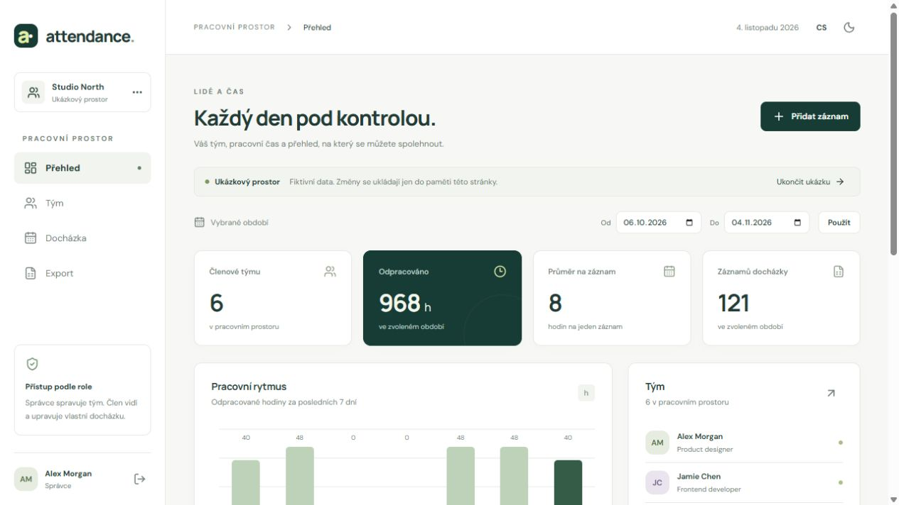
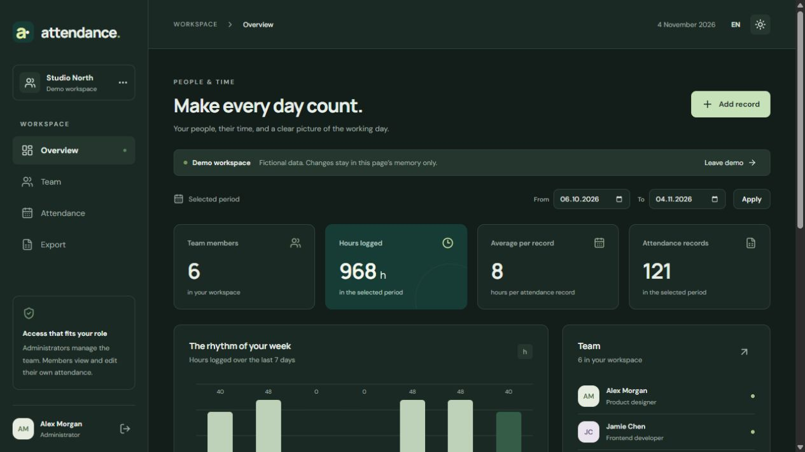

# Attendance Workspace

A focused workspace for people and time. React 19, Vite 8 and a responsive interface in Czech and English, with light and dark themes.

## Try locally

Requires Node 24.15 or newer in the 24 LTS line.

```sh
npm ci
npm run dev
```

Open `http://127.0.0.1:5173`. Choose the interactive demo to explore fictional team members, attendance, editing, filters and CSV export. Demo changes stay in page memory and reset on reload. Appearance and language preferences are stored locally.

To use real accounts, start [AttendanceTrackerApi](https://github.com/amonvo/AttendanceTrackerApi) on port 5135 and initialize its database using the backend README. During paired PR review, check out `codex/professional-attendance` in both repositories. Vite proxies `/api` to the API. An administrator creates member accounts. Members see their own records, and server authorization enforces access.

## Features

- Overview with team totals, recorded hours, weekly activity and recent records.
- Team management with database-backed positions and administrator/member roles.
- Attendance creation, editing and explicit deletion, with date and member filters.
- CSV export of filtered records with UTF-8 BOM, quoted values and formula neutralization.
- Responsive navigation, keyboard-accessible dialogs, loading/error/empty states and retained drafts after failed saves.
- CS/EN translations, locally served fonts, local initials-based avatars and theme preferences.

Requests use same-origin HttpOnly cookie authentication and CSRF request tokens. Client-side environment variables are public build-time configuration. Keep secrets on the server.

## Checks

```sh
npm run lint
npm test
npm run build
```

Tests cover all user and attendance mutations under HTTP failures, network errors, CSRF rotation, CSV handling and editor behavior. CI runs lint, tests, build, a production dependency audit and a container build.

## Containers

Use `docker compose up --build` from the sibling backend directory after setting its `.env` bootstrap credentials. Open `http://localhost:3000`. Nginx serves the UI and proxies `/api` to the backend. The image uses Node 24 for build and an unprivileged Nginx runtime. Production deployment requires HTTPS and coordinated backend configuration.

## Structure

`src/App.jsx` holds workspace state and navigation, `src/components` contains dialogs and editors, `src/services/api.js` centralizes HTTP/CSRF handling, and `src/lib/data.js` contains reporting, dates and fictional demo data. `src/i18n.js` contains both languages. Styles and breakpoints are in `src/index.css`.

Current reporting uses same-day local times. Overnight records must be split. Invitation/reset flows, payroll calculations and compliance reporting are roadmap items. License clarification is pending author review, as the original MIT statement had no accompanying license file.

## Interface preview

The screenshots show the fictional demo workspace in Czech and English.




